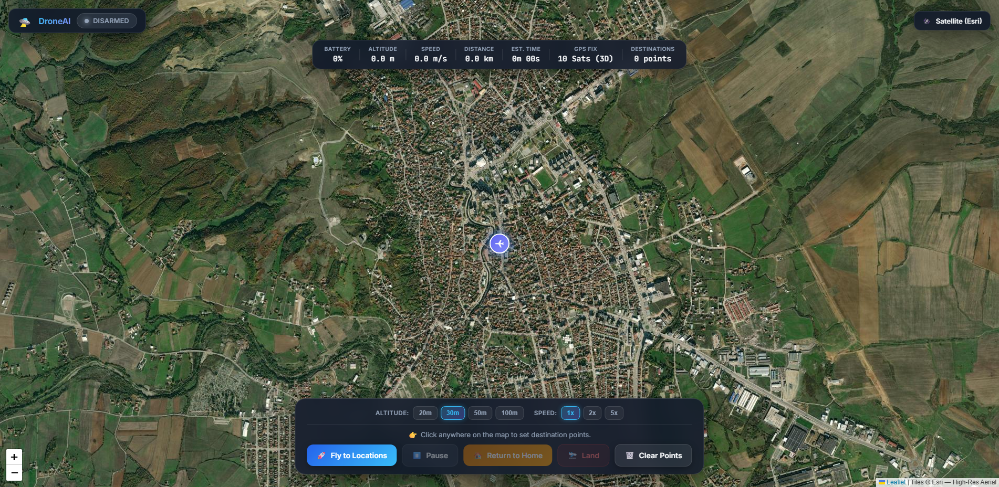
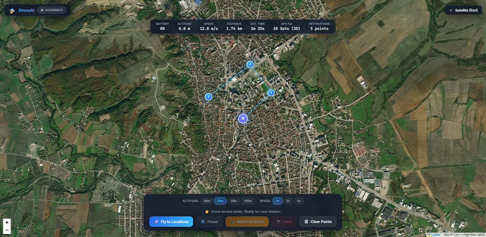

# 🛸 DroneAI

> Production-grade autonomous drone control system with a streamlined, real-time flight command center. Built with Python, Flask, WebSockets, and open-source GIS satellite mapping. Features 1-click autonomous flight, 10 Hz real-time telemetry, Haversine-based ETA/distance tracking, mid-air loitering, and smart low-battery Return-to-Home failsafes.

[]()
[]()
[]()


*The DroneAI Command Center mid-flight — high-resolution Esri satellite map, 10 Hz telemetry HUD, dynamic waypoint tracking, live distance & ETA countdown, altitude/speed presets, and emergency controls.*

---

## Quick Start

```bash
# 1. Clone the repository
git clone https://github.com/armansuri300105/Drone.git
cd Drone

# 2. Setup virtual environment & install dependencies
python -m venv venv
venv\Scripts\activate          # Windows
# source venv/bin/activate     # macOS / Linux
pip install -r requirements.txt

# 3. Launch the dashboard
python run_simulation.py
```

→ Open **http://localhost:5000** in your browser. The map automatically loads centered on the Home Base coordinates (`42.3803°N, 20.4308°E`).

---

## How to Fly a Mission

The command center features an intuitive, 1-click autonomous workflow:

```
[1. Click Waypoints on Map] ➔ [2. Select Alt/Speed] ➔ [3. Click "Fly to Locations"] ➔ [4. Auto Flight & RTH]
```

### Step 1 — Select Destination Points
- Click anywhere on the map to place destination waypoints (1, 2, 3...).
- A dashed cyan flight line automatically connects them from the Home base 🏠.
- The **Distance** (e.g. `1.45 km`) and **Est. Time (ETA)** automatically compute in real-time on the top HUD.
- *Tip:* You can drag any marker on the map to adjust coordinates before takeoff.



### Step 2 — Set Cruise Altitude & Speed (Optional)
- **Altitude Chips**: Choose `[20m]`, `[30m]`, `[50m]`, or `[100m]` to set your target cruise altitude.
- **Speed Chips**: Toggle between `[1x]`, `[2x]`, or `[5x]` to accelerate simulation speed without waiting in real time.

### Step 3 — Launch Flight (1-Click)
- Click **🚀 Fly to Locations**.
- The platform automatically handles the entire flight sequence:
  1. Boots the simulation engine (if idle).
  2. Acquires GPS 3D lock (10 satellites).
  3. Uploads waypoint coordinates to the flight controller.
  4. Arms the drone.
  5. Takes off and climbs to your cruise altitude.
- The drone flies smoothly along the path, and waypoints turn green as they are reached.


### Step 4 — In-Flight Controls
- **⏸️ Pause / Loiter**: Freeze the drone mid-air at its current GPS location and altitude. Click **▶️ Resume** to continue the mission.
- **🏠 Return to Home (RTH)**: Aborts the current mission, climbs to safe cruise altitude, navigates back to Home Base coordinates, and touches down.
- **🛬 Land**: Immediately initiates a controlled vertical descent at the current location and disarms on ground contact.
- **🗑️ Clear Points**: Clears existing markers so you can plot a fresh route.



### Step 5 — Smart Auto-RTH Failsafe
- **Low-Battery Auto-Recovery**: If battery level drops to **$\le$ 20%** during flight:
  - The telemetry HUD pulses amber.
  - A warning toast alerts the operator: `⚠️ Low battery! Auto-RTH initiated`.
  - The drone automatically aborts its mission and returns home to land safely before power is depleted.

---

## Key Capabilities

### 🛰️ 100% Free & Open-Source GIS Maps (No API Keys)
- **Esri World Imagery (Satellite — Default)**: High-resolution aerial photography showing real-world trees, buildings, fields, and runways.
- **OpenStreetMap (Streets)**: Clean community street layout with road names and infrastructure labels.
- **OpenTopoMap (Topographic)**: Elevation contours and terrain relief for obstacle and ridge avoidance.
- *Click the top-right button (`Satellite (Esri)`) to cycle between map styles instantly.*

### 📊 Real-Time 10 Hz Telemetry HUD
- **Live Metrics**: Battery percentage, altitude (meters), ground speed (m/s), 3D GPS satellite lock count, and destination counter.
- **Haversine Math Engine**: Live computation of total planned route distance, remaining flight distance, and countdown ETA.
- **Attitude & Heading Tracking**: Dynamic drone icon rotating in real-time to match compass heading.

### 🛡️ Safety & Failsafe Subsystems
- **Battery Failsafe**: Automatic Return-to-Home escalation when battery drops below 20%.
- **Landing Guard**: Prevents race conditions and stops waypoint execution upon touchdown.
- **Geofence Enforcement**: Soft-warning and hard boundary monitoring.

---

## Sample Screenshots

| State | Preview | Description |
| :--- | :--- | :--- |
| **Idle / Home Base** |  | Fresh boot with satellite imagery, Home Base marker 🏠, and telemetry HUD ready. |
| **Mission in Flight** |  | Drone ✈ navigating waypoints with live flight path, distance, and ETA countdown. |
| **Return to Home (RTH)** |  | Autonomous abort & recovery heading straight back to Home coordinates. |

---

## Testing

Run the test suite offline with pytest:

```bash
pytest tests/ -q
```

**806+ tests** covering core flight controllers, failsafe triggers, navigation sensors, and mission execution.

---

## Project Structure

```
├── core/                 # Flight controller, modes (AUTO, LOITER, RTL, LAND), failsafes, missions
├── simulation/           # Web simulation server & frontend dashboard
│   ├── templates/
│   │   ├── dashboard.html                    # Streamlined 1-click command center
│   │   └── dashboard_advanced_backup.html    # Full multi-panel enterprise backup
│   └── web_server.py                         # Flask & Socket.IO 10 Hz telemetry server
├── sensors/              # Simulated GPS, IMU, battery, camera, lidar, wind
├── docs/screenshots/     # Live HD captures of the flight dashboard
├── requirements.txt      # Python dependencies
└── run_simulation.py     # Main application launcher
```

---

## License

MIT — see [LICENSE](LICENSE) for details.
