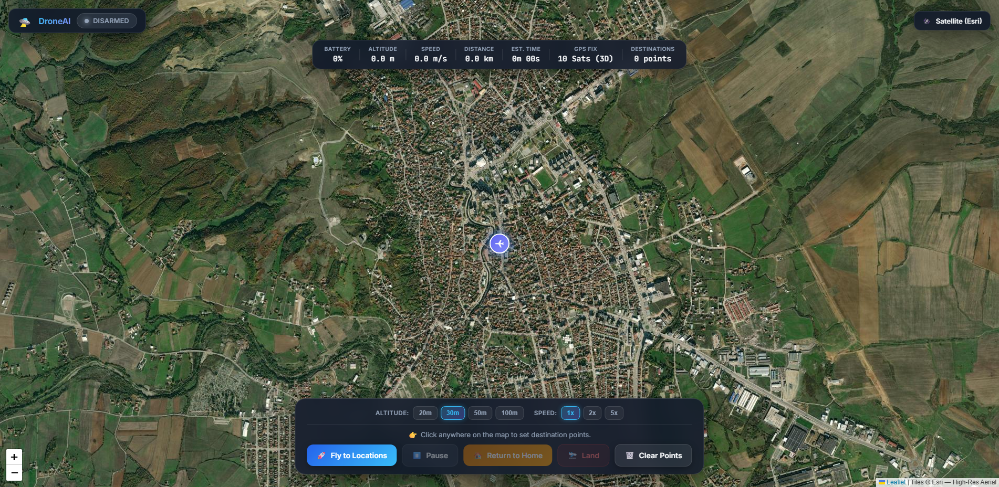
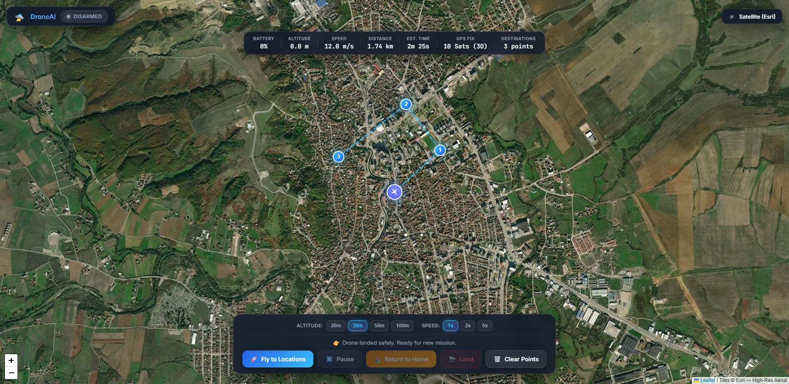

# DroneAI — Sample Screenshots

Live 1080p captures of the running DroneAI command center at `http://localhost:5000/`.

---

## 1. Idle Dashboard (Home Base)

Right after booting `python run_simulation.py`. The high-resolution Esri satellite map loads centered on the Home Base coordinates (`42.3803°N, 20.4308°E`). The drone is disarmed and resting at the launch pad.



**Visible Elements:**
- **Top Bar:** 🛸 DroneAI logo, `DISARMED` status badge, and Open-Source Map Style cycler (`Satellite (Esri)`).
- **Center Map:** High-resolution aerial satellite imagery with Home Base 🏠 and Drone ✈ markers.
- **Top HUD:** Real-time telemetry monitoring: Battery (`100%`), Altitude (`0.0 m`), Speed (`0.0 m/s`), Distance (`0.0 km`), ETA (`0m 00s`), and GPS Fix (`10 Sats (3D)`).
- **Bottom Card:** Altitude presets (`20m`, `30m`, `50m`, `100m`), Speed presets (`1x`, `2x`, `5x`), and primary control buttons.

---

## 2. Mission in Flight

After clicking waypoints on the map and clicking **🚀 Fly to Locations**. The drone takes off, climbs to cruise altitude, and autonomously navigates the cyan dashed flight path.



**What's Happening:**
- **Status:** Green `FLYING` status badge.
- **Waypoints:** Numbered pins connected by dashed flight path (points turn green as reached).
- **Metrics HUD:** Live calculation of remaining distance and countdown ETA.
- **Attitude:** Purple ✈ drone marker dynamically rotates to match compass heading.
- **Controls:** `⏸️ Pause` (Loiter), `🏠 Return to Home`, and `🛬 Land` buttons become active.

---

## 3. Return to Home (RTH)

After clicking **🏠 Return to Home** (or triggered automatically by low battery $\le 20\%$). The drone ceases waypoint progression, turns toward Home Base, and begins its recovery trajectory.


**What's Happening:**
- **Status:** Amber `RETURNING HOME` badge.
- **Navigation:** The drone flies directly to Home Base coordinates (`42.3803°N, 20.4308°E`).
- **Touchdown:** Upon arriving over Home Base, the drone executes a controlled vertical descent to 0m and automatically disarms.

---

## How These Were Captured

Captured via Selenium WebDriver in headless Google Chrome at 1920×1080 resolution:

```bash
python scripts/capture_screenshots.py
```
